# Carlamayo 분산 데모 환경 사용 설명서

본 문서는 구성과 검증이 완료된 인스턴스 두 대를 인계받아 데모를 운영하는 담당자를 대상으로, 운영 절차와 각 단계의 정상 동작 기준을 기술한다.
환경 구성 절차는 [porting-guide.md](porting-guide.md)를, 실행 옵션 전체는 [demo-runbook.md](demo-runbook.md)를 참조한다. 본문의 `<...>`는 해당 환경의 값으로 대체한다.

| 항목 | 내용 |
|---|---|
| 담당자 / 문의 | `<이름, 연락처>` |
| 저장소 | https://github.com/JwonMoon/carlamayo-distributed (`main` 브랜치. 두 인스턴스 모두 `~/carlamayo`에 클론되어 있음) |
| 인계일 | `<날짜>` |

---

## 1. 개요

### 1.1 시스템 개요

- CARLA 시뮬레이터(인스턴스 A)와 Alpamayo 1.5 추론 서버(인스턴스 B)를 서로 다른 EC2 인스턴스에서 실행하고 gRPC로 연결한 closed-loop 자율주행 데모 환경이다.
- A의 인터페이스 프로그램 `carlamayo.py`가 카메라 4장의 영상을 1초에 한 번 B로 전송하고, B가 반환한 궤적으로 A의 차량을 제어한다.

### 1.2 출처

- 원본은 오픈소스 [aveeslab/Carlamayo](https://github.com/aveeslab/Carlamayo)이다. NVIDIA Alpamayo 모델을 CARLA에 연동해 open-loop·closed-loop로 실행하는 프로젝트이며, 단일 GPU 머신에서 CARLA와 모델을 함께 실행한다.
- 본 저장소는 원본을 포크하여 모델 추론만 별도 인스턴스(B)로 분리하였다. 추가된 구성 요소는 gRPC 추론 서버와 원격 어댑터, `--inference-server` 실행 옵션, 실행별 결과 폴더와 측정 도구, 설치·검증 스크립트, 한국어 문서이다. 데이터 수집, 실행 모드, pygame 화면은 원본과 동일하다.
- 변경 내역 전체는 [changes-from-upstream.md](changes-from-upstream.md)에 정리되어 있다.

### 1.3 지원 기능

| 기능 | 내용 | 확인 지표 |
|---|---|---|
| closed-loop (동기) | 모델이 차량을 직접 제어한다. 추론 중 시뮬레이션을 정지시켜 궤적이 해당 장면에 정확히 적용된다 | 카메라 영상 위 적색 궤적, 차선 유지·교차로 통과 |
| closed-loop (비동기) | 시뮬레이션을 정지시키지 않고 추론을 병행한다. 궤적이 왕복 시간만큼 지연된다 | 화면 연속 진행, 궤적 지연 시간(`Trajectory age`) |
| navigation + CFG | 자연어 주행 지시를 실행 중 변경하며, 가중치(CFG)로 지시 강도를 조절한다 | 패널의 현재 지시, 지시 변경 시 주행 변화 |
| VQA | 차량을 정지시킨 상태에서 장면에 대한 질문에 모델이 답변한다 | 패널·터미널의 답변 |
| 궤적 후보 다중 출력 | 서버 옵션으로 후보 궤적 N개를 생성하여 함께 표시한다 | 백색 후보선 N개와 적색 선택선 |
| open-loop | 녹화 데이터를 재생하며 궤적만 산출한다. CARLA 없이 원격 추론 경로를 검증한다 | 프레임별 추론 시간, 결과 영상 |
| 측정 리포트 | 실행마다 왕복 시간, 추론 시간, 네트워크 오버헤드, GPU 사용량을 기록한다 | `runs/<run_id>/summary.md` |

---

## 2. 시스템 구성



| 항목 | 인스턴스 A (시뮬레이터) | 인스턴스 B (추론) |
|---|---|---|
| 역할 | CARLA 서버, 인터페이스 `carlamayo.py`, pygame 화면 | 추론 서버 `alpamayo_server.py`, Alpamayo 1.5 모델 |
| 인스턴스 이름 | `vs-advancedsw-lgadas-simulator-2` | `vs-advancedse-alpamayo-2` |
| 인스턴스 ID | `i-070688c185887959c` | `i-0d31463ea29c72110` |
| 인스턴스 타입 | g5.2xlarge (A10G 24 GB) | g6e.xlarge (L40S 48 GB) |
| 사설 IP | `172.31.51.167` | `172.31.31.226` |
| 공인 IP | 탄력적 IP 미설정. AWS 콘솔의 인스턴스 화면에서 확인한다(stop/start 시 변경됨) | 동일 |
| SSH | `ssh -i vs-advancesw.pem ubuntu@<A 공인 IP>` | `ssh -i vs-advancesw.pem ubuntu@<B 공인 IP>` |
| 화면 접속 | NICE DCV `https://<A 공인 IP>:8443`, 가상 세션(XFCE) `simulator-session`. 계정은 §3.2 | 없음 |
| OS | Ubuntu 26.04 LTS | Ubuntu 26.04 LTS |
| 키페어 | `vs-advancesw.pem` | 동일 |

- 두 인스턴스는 구성과 동작 검증이 완료된 상태로 인계한다. 재구성이 필요한 경우 [porting-guide.md](porting-guide.md)를 따른다.
- B에서는 추론 서버만 실행한다. 실행 모드 전환(open/closed, 비동기, navigation, CFG, VQA)은 모두 A에서 수행한다.
- 화면이 필요한 프로세스는 A의 pygame 창 하나이다. CARLA 서버와 추론 서버는 화면 없이 동작한다.
- Hugging Face 인증은 인계자 계정으로 설정되어 있다. 본인 계정으로 변경할 경우 porting-guide §4.2를 따른다(모델 접근 권한 승인 필요).
- 이하 `[A]`, `[B]`는 명령을 실행하는 인스턴스를, `[A·DCV]`는 DCV 화면 내 터미널을 뜻한다.

---

## 3. 운영 절차

실행 순서는 3.1 → 3.2 → 3.3 → 3.4이며, 3.5 이후는 필요에 따라 수행한다. 각 항목의 **정상 동작 기준**을 만족하지 않으면 §4를 참조한다.

### 3.1 [B] 추론 서버 실행

```bash
tmux new -s server
cd ~/carlamayo && source a_venv/bin/activate
python alpamayo_server.py --version 1.5 --host 172.31.31.226 --port 50051
# Ctrl+B, D 로 세션에서 빠져나온다. 재접속은 tmux attach -t server
```

**정상 동작 기준**
- 로그 마지막 줄에 `SERVING Alpamayo 1.5 ... warmed_up=True`가 출력된다.
- `nvidia-smi`에서 약 21~24 GB의 GPU 메모리를 사용한다.
- 최초 실행 시 모델 가중치(약 22 GB) 다운로드로 수십 분이 소요된다. `401`/`403` 오류는 모델 접근 권한 문제이다(§4).

### 3.2 [A] DCV 화면 접속

```bash
# [A] SSH 터미널
start_dcv        # DCV 세션을 확인하고, 없으면 생성한다. 인스턴스 stop/start 후에는 세션이 사라지므로 매번 실행한다
```

브라우저에서 `https://<A 공인 IP>:8443`에 접속한다. 자체 서명 인증서 경고는 최초 1회 수락한다. 계정 `ubuntu`, 비밀번호 `lge123`으로 로그인하면 바탕화면이 표시된다.
터미널은 상단 패널의 터미널 아이콘 또는 바탕화면 우클릭 → Applications → Terminal Emulator로 연다.

**정상 동작 기준**
- `start_dcv` 출력에 `Session: 'simulator-session' ... type:virtual`이 표시된다.
- 브라우저에 바탕화면과 터미널이 표시되고, 해당 터미널에서 `echo $DISPLAY`가 `:0`을 출력한다.

**알려진 제약.** 본 환경은 Ubuntu 26.04라 DCV를 가상 세션(XFCE)으로만 쓸 수 있다. 26.04의 GNOME 50이 X11 세션을 지원하지 않아 GPU 화면을 직접 중계하는 콘솔 세션이 동작하지 않기 때문이다.
가상 세션은 소프트웨어 렌더링이라 화면 반응이 느리고 터미널 입력이 밀리는 등 사용성이 떨어진다. 개선하려면 A를 Ubuntu 22.04 또는 24.04로 재구성하여 콘솔 세션(GNOME, GPU 직접 렌더링)을 쓴다([porting-guide.md](porting-guide.md) §0.2, §1.4.2).

### 3.3 [A] CARLA 서버 실행

```bash
# [A] SSH 터미널 (화면 없이 실행, 기본)
tmux new -s carla
unset DISPLAY
cd ~/carla && ./CarlaUE4.sh -RenderOffScreen -quality-level=Epic
# Ctrl+B, D
```

시뮬레이터 화면 자체를 확인하려면 DCV 터미널에서 `-RenderOffScreen` 옵션을 제외하고 실행한다. 이 경우 시뮬레이터 창이 추가로 표시되며 GPU 사용량이 증가한다.

**정상 동작 기준**
- 실행 후 10~20초 내에 `nvidia-smi`에 `CarlaUE4` 프로세스가 약 6 GB로 표시된다.
- 실행 직후 `Signal 11`로 종료되면 `DISPLAY` 환경변수 문제이다(§4).

### 3.4 [A·DCV] closed-loop 주행

```bash
cd ~/carlamayo && source venv-sim/bin/activate && export CARLA_ROOT=~/carla
python carlamayo.py --loop closed --version 1.5 --inference-server 172.31.31.226:50051 --run-tag sync
```

2~3분 관찰 후 `Esc`로 종료한다. 실행 중 조작은 `Ctrl+P`(일시정지/재개), `Esc`(종료)이다.

**정상 동작 기준**
- pygame 창에 카메라 영상과 적색 궤적이 표시되고, 하단 패널에 `RUNNING | frame N | NN km/h | inference 2.xx s`가 갱신된다.
- 터미널에 `[Frame k] Inference: 2.xx s`가 약 1초 간격으로 출력된다. 추론 중 화면이 잠시 정지하는 것은 동기 모드의 정상 동작이다.
- `Esc` 종료 후 `runs/<run_id>/`에 `*.mp4`, `log.txt`, `profile_client*.csv`가 생성된다. 창을 강제 종료하면 영상이 저장되지 않는다.

### 3.5 [A·DCV] 실행 모드 전환

`BASE` = `python carlamayo.py --version 1.5 --inference-server 172.31.31.226:50051`. 궤적 후보 다중 출력을 제외하고 B는 변경하지 않는다.

| 모드 | 명령 | 정상 동작 기준 |
|---|---|---|
| 비동기 | `BASE --loop closed --async --run-tag async` | 추론 중에도 화면이 정지하지 않는다. 터미널에 `Trajectory age: N.NN s`가 출력된다. 곡선 구간에서 반응이 늦는 것은 정상이다 |
| navigation + CFG | `BASE --loop closed --mode navigation --navigation-text "Turn right in 30m" --navigation-weight 1.5 --run-tag nav` | 패널에 `Active nav: Turn right in 30m \| weight: 1.50`이 표시된다. 입력창에 `Turn left in 20m \| 1.5` 입력 후 Enter → 터미널에 `Navigation updated:`. 해제는 `\| 1.0` 입력 후 Enter. 지시는 해제 전까지 매 추론에 적용된다 |
| VQA | `BASE --loop closed --mode vqa --vqa-question "What is ahead?" --run-tag vqa` | 차량이 정지한 상태에서 수 초 후 패널 `Answer:`와 터미널 `A:`에 답변이 출력된다. 입력창에 다른 질문 입력 후 Enter → `VQA question updated:` |
| 궤적 후보 4개 | [B] `tmux attach -t server` → Ctrl+C → 3.1 명령에 `--num-traj-samples 4` 추가하여 재실행 → [A·DCV] `BASE --loop closed --run-tag samples4` | 백색 후보선 4개와 적색 선택선 1개가 표시되고 터미널에 `Selected traj sample: k/3`이 출력된다. 종료 후 B를 옵션 없이 재실행한다 |

### 3.6 [A] open-loop

```bash
# 녹화 데이터가 없는 경우에만 실행 (CARLA 서버 필요, 1~2분 후 Ctrl+C)
python data_collect.py
# 녹화 데이터 재생 + 원격 추론
python carlamayo.py --loop open --version 1.5 --data-root carla_data --inference-server 172.31.31.226:50051 --run-tag remote
```

**정상 동작 기준**
- `Run folder: runs/<run_id>`가 출력되고 프레임마다 `[Frame k] Inference: 2.xx s`가 출력된다.
- 종료 후 `runs/<run_id>/carla_alpamayo_open_loop_result.mp4`가 생성된다.

### 3.7 [A] 측정 결과 확인 및 회수 <sub>(측정 항목과 분석 도구는 보완 중)</sub>

```bash
RUN=$(ls -t runs | head -1)
tools/fetch_server_profile.sh $RUN && python tools/analyze_run.py runs/$RUN
sed -n 1,30p runs/$RUN/summary.md
```

**정상 동작 기준**
- `summary.md`의 headline에 `rtt_mean_s`(왕복 시간), `inference_mean_s`(모델 추론 시간), `overhead_mean_s`(분리로 인한 오버헤드), `request_mb`(요청 크기)가 기록된다.
- 그래프는 `runs/$RUN/plots/`에 생성된다.

측정이 필요 없으면 실행 명령에 `--no-profile`을 추가한다. 프로파일 CSV를 기록하지 않으며, 영상과 로그가 담기는 결과 폴더 `runs/<run_id>/`는 그대로 생성된다.

결과 회수: 로컬 PC에서 `scp -i <pem> -r ubuntu@<A 공인 IP>:~/carlamayo/runs/<run_id> ./results/`

### 3.8 종료

| 순서 | 위치 | 작업 |
|---|---|---|
| 1 | [A·DCV] | 클라이언트 창에서 `Esc` (영상 저장) |
| 2 | [A] | `tmux attach -t carla` → Ctrl+C |
| 3 | [B] | `tmux attach -t server` → Ctrl+C |
| 4 | AWS 콘솔 | 두 인스턴스 stop (시간당 과금). 재시작 시 공인 IP가 변경될 수 있으며 DCV 세션은 3.2에 따라 재생성한다 |

### 3.9 일괄 점검

문제 위치가 불명확한 경우 다음 스크립트가 환경·연결·서버 상태를 PASS/FAIL로 출력한다. 두 스크립트 모두 **B의 추론 서버(3.1)가 실행 중이어야** 서버·연결 항목이 PASS가 된다. CARLA 서버는 필요하지 않다.

```bash
# [B]  서버 실행 후
deploy/scripts/verify-inference-host.sh --serving
# [A]  B 서버 실행 후
deploy/scripts/verify-sim-host.sh --link
```

옵션(`--serving`, `--link`) 없이 실행하면 서버 없이도 각 인스턴스의 환경 항목(드라이버, venv, 의존성, `hosts.env`)만 점검한다.

---

## 4. 문제 해결

| 증상 | 원인 및 조치 |
|---|---|
| `no inference server at 172.31.31.226:50051 after 30s` | B의 추론 서버가 실행 중이 아니다. [B] `ss -ltnp \| grep 50051`로 확인 후 3.1 수행. 실행 중이면 [A] `nc -zv 172.31.31.226 50051`로 연결 확인 |
| `nc` 응답 없음 (timed out) | B 보안그룹이 A의 TCP 22·50051을 허용하지 않는다. B 인바운드에 A의 보안그룹 ID를 추가 |
| `server is not warmed up` | 모델 로드·워밍업 진행 중. B 로그에 `SERVING`이 출력될 때까지 대기 |
| B 로그에 `401`/`403` | Hugging Face 모델 접근 권한 미승인 또는 계정 불일치. porting-guide §4.2 |
| `serves Alpamayo '2' but --version '1.5'`, `NUM_FRAMES: client != server` | A·B의 `--version` 또는 커밋 불일치. 양쪽에서 `git pull` 후 재실행 |
| DCV 접속이 Connecting·로딩에서 정지 | [A] `dcv list-sessions`가 비어 있으면 `start_dcv`. 지속되면 `sudo systemctl status dcvserver`, 보안그룹 8443, 인증서 경고 수락 여부 확인. 네이티브 DCV 클라이언트 사용 가능 |
| CARLA 실행 직후 `Signal 11` / `Segmentation fault` | 셸의 `DISPLAY`가 존재하지 않는 X 서버를 가리킨다. `unset DISPLAY` 후 재실행. `~/.bashrc`의 `export DISPLAY` 줄 삭제 |
| pygame 창 미표시 | SSH 터미널에서 실행됨. DCV 터미널에서 실행하거나 `export DISPLAY=:0`. 창 없이 실행하려면 `--no-pygame-ui` |
| 영상 미저장 | 창 강제 종료. `Esc` 또는 Ctrl+C로 종료 |
| 주행 불안정·반응 지연 | 비동기 모드이거나 navigation 지시가 남아 있다. 동기 모드로 실행하고 `\| 1.0` Enter로 지시 해제 |

추가 항목과 상세 원인은 [porting-guide.md](porting-guide.md) §8, [demo-runbook.md](demo-runbook.md) 부록을 참조한다.

---

## 5. 유의 사항

- 주행 품질 시연은 동기 모드(기본), 실시간성·궤적 지연 시연은 비동기 모드(`--async`)로 수행한다. 서버 설정은 동일하다.
- navigation 지시는 해제 전까지 매 추론에 적용된다. 회전 완료 후 `| 1.0` Enter로 해제한다.
- VQA는 차량 정지 상태에서만 동작한다.
- 영상은 메모리에 누적 후 종료 시 저장된다(1080p 10분 ≈ 6 GB). 2~3분 단위로 나누어 실행한다.
- `DISPLAY` 환경변수는 pygame 창에만 필요하다. CARLA 서버, 추론 서버, open-loop, 측정은 `DISPLAY` 없이 실행하며 `~/.bashrc`에 고정하지 않는다.
- 스크립트(`deploy/scripts/*`, `tools/fetch_server_profile.sh`)는 `deploy/hosts.env`의 주소를 사용한다. 명령줄의 B 주소(`172.31.31.226`)는 직접 입력한다.
- Hugging Face 토큰은 B에만 둔다. gRPC는 VPC 내부 평문 통신이며 50051 포트를 외부에 개방하지 않는다.

---

## 6. 참고 문서

| 문서 | 내용 |
|---|---|
| [demo-runbook.md](demo-runbook.md) | 데모 전체 순서와 기대 출력(1부), 실행 옵션·open-loop 경로·parity·live-open·공식 노트북(2부) |
| [porting-guide.md](porting-guide.md) | 환경 구성 절차. 드라이버, DCV, CARLA 바이너리, 문제 해결 |
| [validation-checklist.md](validation-checklist.md) | 환경별 검증 기록 |
| [distributed-architecture.md](distributed-architecture.md) | 시스템 구조와 데이터 교환 명세 |
| [changes-from-upstream.md](changes-from-upstream.md) | 원본 대비 변경 내역 |
| [aveeslab/Carlamayo](https://github.com/aveeslab/Carlamayo) | 원본 오픈소스 |
